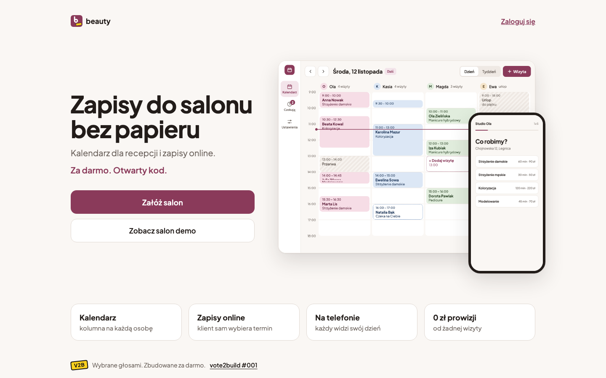
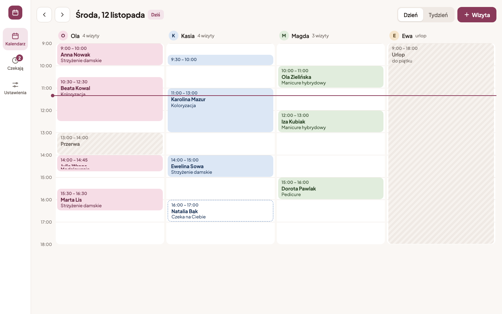
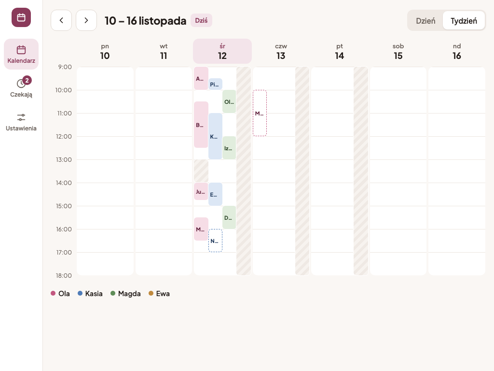
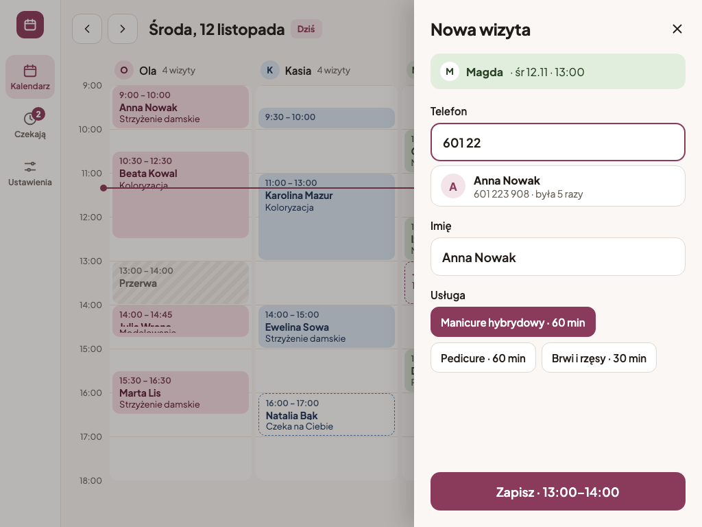
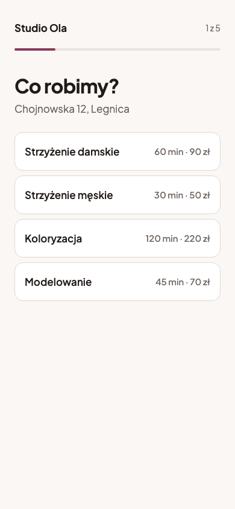
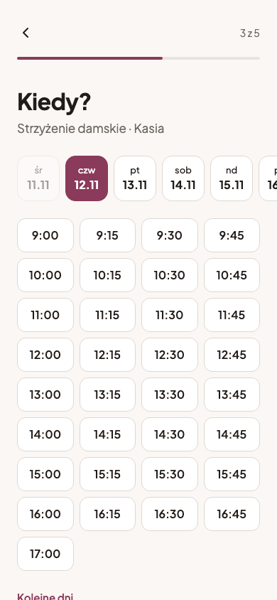
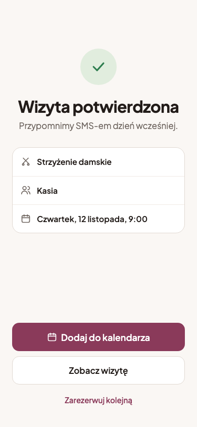
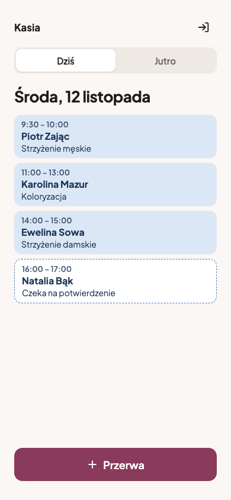
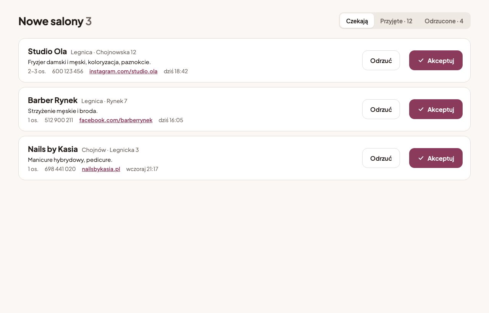

# beauty

English · [Polski](README.pl.md)

A free, open-source booking system for small hair and beauty salons: a reception calendar that replaces the
paper notebook, and a page where clients book a visit themselves. No commission, no software subscription.
An alternative to Booksy that a salon can also run on its own server.

**Live:** https://beauty.vote2build.com · **Demo salon:** https://beauty.vote2build.com/demo



The interface is in Polish (the first salons are in Poland). The code, comments and docs are in English.

## Where it comes from

beauty is project #001 of [vote2build](https://vote2build.com/p/1): a public board where small businesses
describe a problem, people vote, and the ideas that pass the threshold get built and given away as open source.

## What it does

### For the salon

One column per person, visits as blocks, drag a visit to move it. Breaks and days off are part of the same
calendar. Online bookings that need a yes from the salon wait in their own list.



| Week view | New visit |
|---|---|
|  |  |

- Day and week calendar, new visit from the reception, drag and drop.
- Services with a length and a price, the team, working hours per person, breaks and days off.
- The database itself refuses two visits for one person at the same time.
- Each stylist has a phone view with only their own day.

### For the client

The client opens the salon's link, picks a service, a person (or "anyone"), a free time, and confirms the
phone number with an SMS code. No account and no app to install.

| Service | Time | Done |
|---|---|---|
|  |  |  |

- Only times in which the whole service fits are offered.
- The confirmation SMS has a link to the visit page: details, status, cancel (until 2 hours before), book again.
- An SMS reminder the day before, sent between 17:00 and 21:00. Nothing is sent between 21:00 and 8:00.
- The visit can be added to the phone's calendar (.ics).

### For the stylist



### For whoever hosts many salons

On an instance with many salons, a new salon is "pending". The owner can use the calendar at once, but online
booking and SMS to clients start only after the platform admin accepts the salon in `/admin`. A rejected salon
cannot log in and its data is removed after 30 days.



Protection against spam: one salon per phone number, at most 3 sign-ups per IP a day, at most 30 pending salons
at a time, a honeypot field, and limits on SMS codes per number and per IP.

### Privacy (GDPR)

Each salon has a privacy page, the booking form asks for consent, and the owner can erase a client from the
visit card (the visit stays, without the name and number). A template of the data processing agreement is in
`docs/umowa-powierzenia.md` (Polish).

## How it is built

- One SvelteKit 2 app (Svelte 5, TypeScript, adapter-node) and one PostgreSQL 16 database.
- Background jobs (SMS reminders) run in the same database through pg-boss. No Redis, no microservices.
- Every table carries `salon_id` and foreign keys are composite, so no row can point into another salon.
- SMS goes through an adapter. The default `log` provider sends nothing: the message is stored and logged.
  A real gateway: SMSAPI.pl (`SMS_PROVIDER=smsapi` and `SMSAPI_TOKEN`).
- Messages are plain GSM text of at most 160 characters; long names are shortened and the link stays whole.
- The app and the database each run within a 256 MB limit, so a small server is enough.

## Run it on your own server (one salon)

You need only Docker with Compose. Node.js is not needed.

```sh
git clone https://github.com/Appnice/beauty.git && cd beauty
cp .env.example .env      # change APP_SECRET and POSTGRES_PASSWORD (e.g. openssl rand -hex 32)
docker compose up -d      # the first start builds the image (a few minutes)
```

Open http://localhost:8080 and click "Załóż salon" (create a salon). The first salon works at once, without
approval, and then sign-up closes. Without an SMS gateway the code is in the log:
`docker compose logs app | grep sms:log`.

- **Domain with HTTPS:** in `.env` set `DOMAIN=salon.example.com` and `PUBLIC_URL=https://salon.example.com`,
  and uncomment `ADDRESS_HEADER` and `PROTOCOL_HEADER`. Then run `docker compose --profile domain up -d`: Caddy
  on ports 80 and 443 gets the certificate by itself. The domain must point to this server.
- **Backup:** `DB_CONTAINER=beauty-db-1 BACKUP_DIR=./backups tools/backup.sh` (for example nightly from cron;
  files older than 14 days are removed). Restore:
  `COMPOSE_FILE_PATH=compose.yaml COMPOSE_PROJECT=beauty tools/restore.sh <file.dump>`.
- **Update:** `git pull && docker compose up -d --build`. Database changes are applied on start.

The hosted instance uses `deploy/compose.yml`; see [docs/deploy.md](docs/deploy.md).

## Development

You need Docker and Node.js 26.

```sh
make db                   # Postgres on 127.0.0.1:55440 (compose.dev.yaml)
make seed                 # the demo salon at /demo
make dev                  # http://localhost:8150
```

Log in to the demo salon with the phone `500 000 001` and the password from `DEMO_MANAGER_PASSWORD`
(default `demo1234`). In the demo salon the SMS codes are shown on the screen.

| Command | What it does |
|---|---|
| `make db` / `make db-stop` / `make db-reset` | start the local Postgres, stop it (data stays), remove it with its data |
| `make migrate` | apply the database changes from `migrations/` |
| `make seed` | create the demo salon again |
| `make dev` | development server on port 8150 |
| `make build` | production build in `build/` (`node build`) |
| `make check` | type check, lint and all tests against the local database |
| `make e2e` | browser tests (headless Playwright) on a fresh `beauty_e2e` database; writes `docs/screens/` |
| `make e2e-chain` | the whole chain in one test: sign-up, approval, booking, cancel |
| `make test`, `make lint`, `make typecheck`, `make format` | the single steps |
| `make deploy-local` | the production image on this machine behind Caddy, smoke tests, memory check, cleanup |
| `make selfhost-check` | checks "cp .env.example .env && docker compose up" on a fresh copy of the repository |

More screenshots of every screen are in [docs/screens](docs/screens).

## Settings (environment variables)

Self-hosting: `.env.example` and `compose.yaml`. Developers can keep their own settings in `.env.dev` (read by
`make`). The main ones:

| Variable | Meaning |
|---|---|
| `DATABASE_URL` | database address |
| `APP_SECRET` | a long random string; signs the links in SMS messages (required in production) |
| `PUBLIC_URL` | public address of the instance, used in SMS links |
| `SMS_PROVIDER`, `SMSAPI_TOKEN`, `SMSAPI_SENDER` | SMS gateway; without a token messages are only stored |
| `SMS_ECHO` | `on` = verification codes shown on the screen (for testing without a gateway) |
| `SINGLE_SALON` | `on` = one-salon install: the first salon is active at once, then sign-up closes |
| `SIGNUP_CODE` | an extra "invite code" field in the sign-up (empty = no code) |
| `ADMIN_PASSWORD` | password to `/admin` (empty = no admin panel) |
| `ADMIN_PHONE`, `ADMIN_NOTIFY_URL` | where the notice about a new salon goes: SMS and/or a POST (e.g. an ntfy topic) |
| `SMS_MONTHLY_LIMIT` | SMS allowance per salon per month; after it, client codes are refused |
| `OPERATOR_NAME` | who runs the instance (the data processor named on the privacy page) |

## Licence

GNU Affero General Public License v3.0 (AGPL-3.0-only); the full text is in [LICENSE](LICENSE). You may use,
change and host it for free. If you offer a changed version to others over a network, share its code too.

© 2026 Appnice
