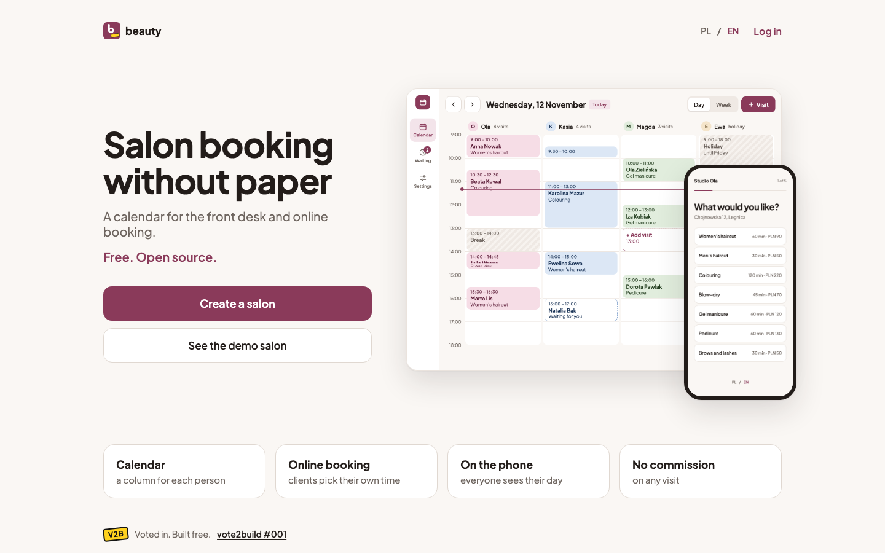
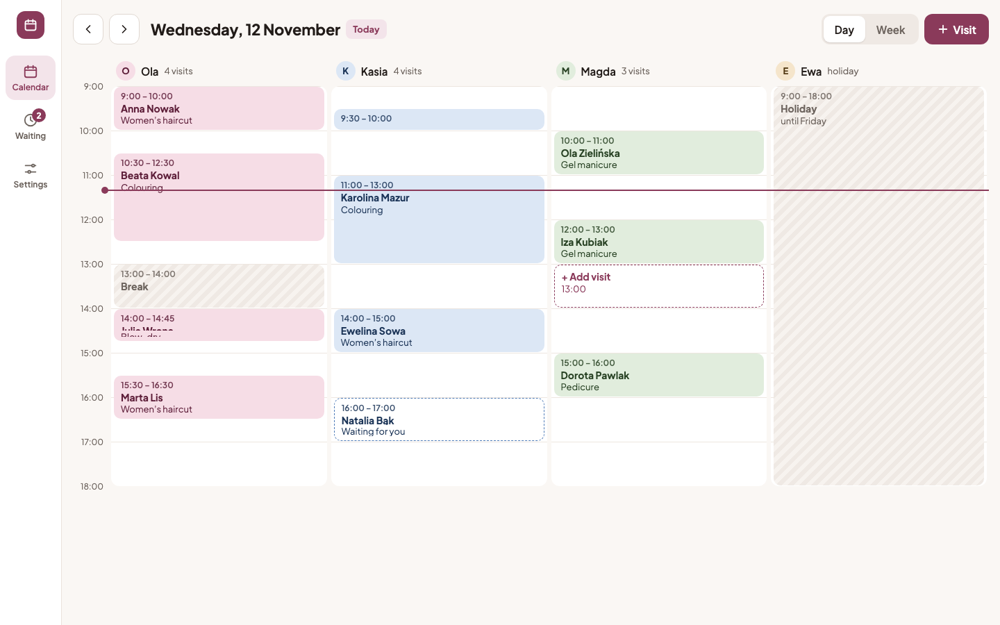
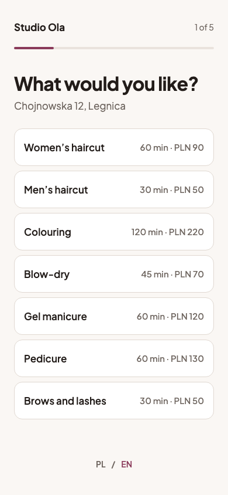
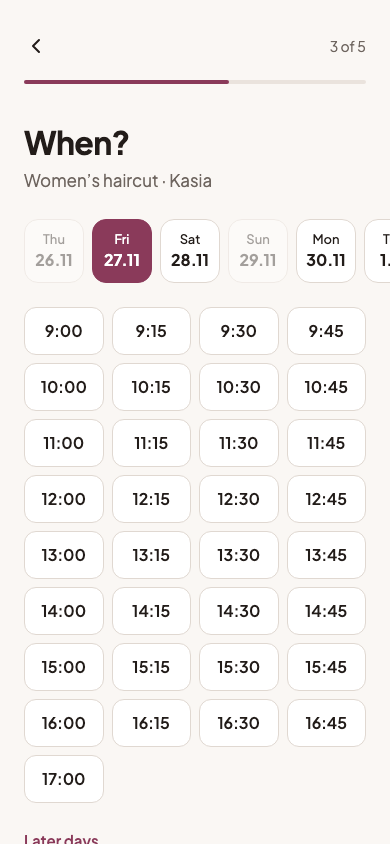
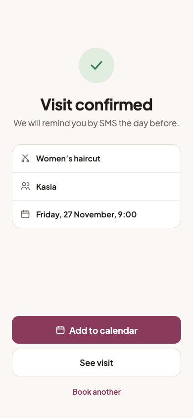
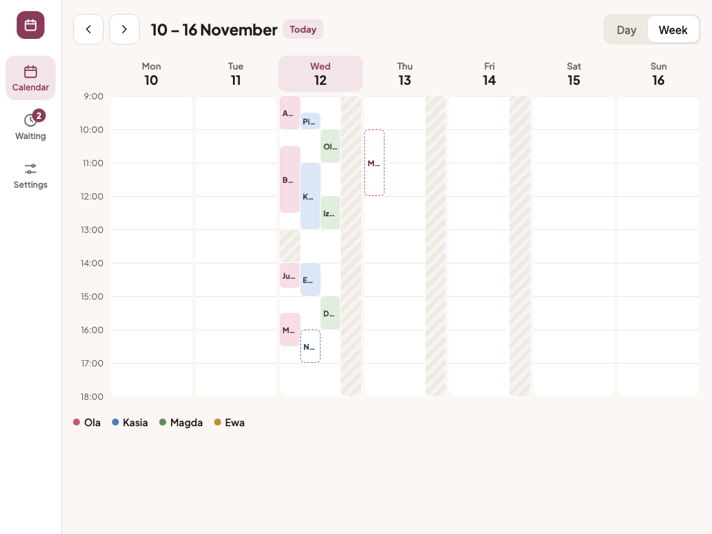
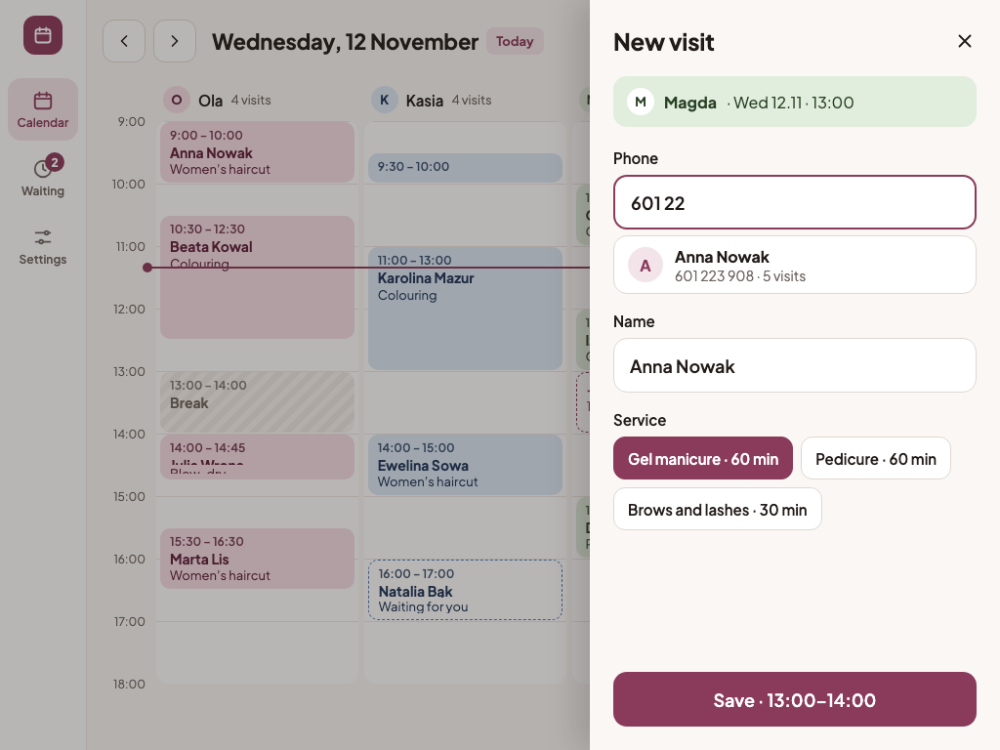
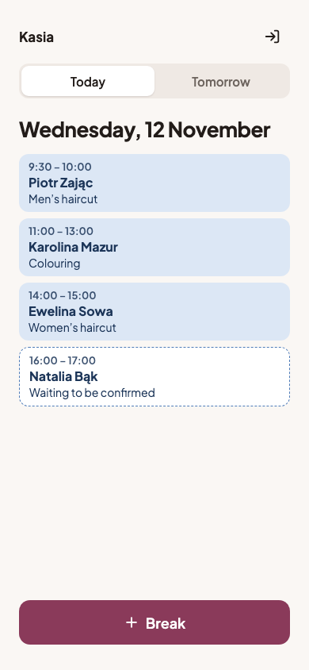
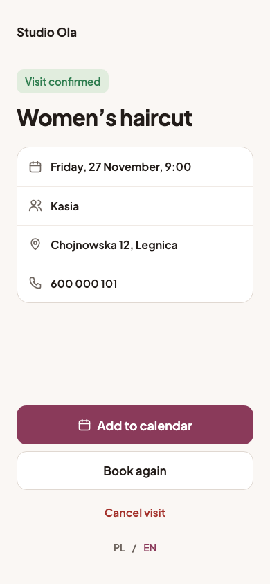
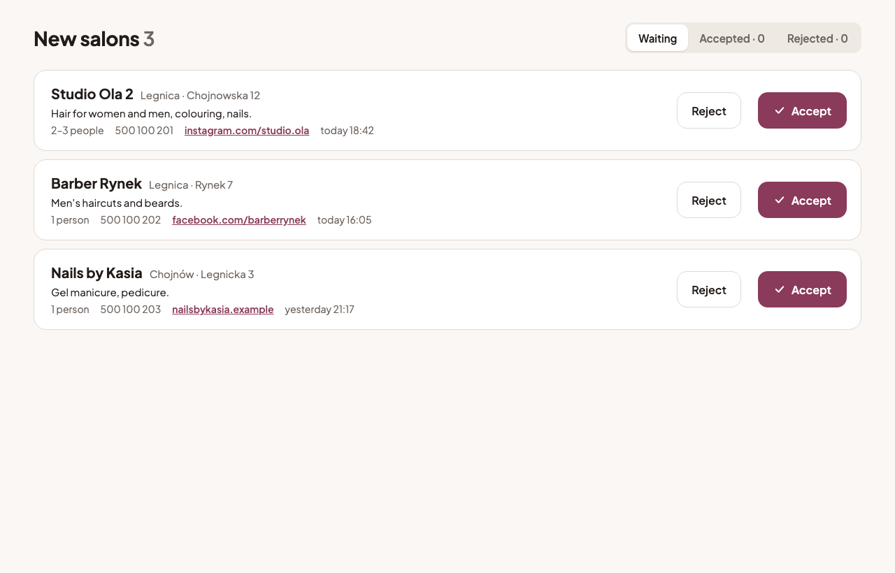

<p align="center">
  
</p>

<h1 align="center">beauty</h1>

<h3 align="center">Salon booking without the paper notebook. Free. No commission. Your own server if you want.</h3>

<p align="center">
  <a href="https://vote2build.com/en/p/1"></a>
  
  
  
  
  
  
  
</p>

<p align="center">
  <a href="https://beauty.vote2build.com/en"><b>Live</b></a> ·
  <a href="https://beauty.vote2build.com/demo?lang=en"><b>Demo salon</b></a> ·
  <a href="https://vote2build.com/en/p/1"><b>Project history</b></a> ·
  <a href="README.pl.md"><b>Polski</b></a>
</p>

<p align="center">
  <a href="https://beauty.vote2build.com/en"></a>
</p>

> [!NOTE]
> **Built through [vote2build](https://vote2build.com/en).** Small businesses describe a problem in their own
> words, people vote, and an idea that reaches the threshold with a pilot company gets built and given away
> as open source. beauty is project **#001**: [its page and build history](https://vote2build.com/en/p/1).
> Voted in. Built free.

<p align="center"><b>Run it for one salon</b> · Docker with Compose · no Node.js needed</p>

```sh
git clone https://github.com/Appnice/beauty.git && cd beauty
cp .env.example .env      # change APP_SECRET and POSTGRES_PASSWORD (e.g. openssl rand -hex 32)
docker compose up -d      # then open http://localhost:8080 and click "Załóż salon"
```

**What it is.** A booking system for small hair and beauty salons, an alternative to Booksy.

- **A calendar for the reception.** One column per person, visits as blocks, drag to move.
- **Clients book themselves.** A link, a service, a free time, an SMS code. No account, no app.
- **Free and yours.** No commission, no subscription for the software. One app and one database.

<p align="center">
  
</p>

<p align="center">
  
  &nbsp;&nbsp;
  
  &nbsp;&nbsp;
  
</p>

> [!TIP]
> Try it without installing anything: open the [demo salon](https://beauty.vote2build.com/demo?lang=en) and
> book a visit. In the demo the SMS code is shown on the screen. The app speaks Polish and English: switch with
> PL / EN on the page, or open `/en`.

## What you get

| | |
|---|---|
| **Reception calendar** | Day and week view, a new visit in a few taps, drag and drop, breaks and days off in the same grid. |
| **Online booking** | The client picks a service, a person or "anyone", and a time. Only times in which the whole service fits are offered. |
| **No double bookings** | The database itself refuses two visits for one person at the same time. |
| **SMS** | Confirmation with a link to the visit, a reminder the day before (17:00 to 21:00), silence from 21:00 to 8:00. |
| **Visit page** | From the SMS link: details, status, cancel until 2 hours before, book again, add to the phone's calendar. |
| **Stylist's phone** | Each person sees only their own day and can add a break. |
| **Waiting list** | Online bookings that need a yes from the salon wait in one place. |
| **Two languages** | Polish and English: screens, dates, error messages and SMS. Each visitor picks with PL / EN; a salon created in English sends English SMS. |
| **Privacy (GDPR)** | A privacy page per salon, consent on the form, erase a client from the visit card. |

<details>
<summary><b>More screens: week, new visit, stylist's phone</b></summary>

<br>

<p align="center">
  
  
</p>

<p align="center">
  
  &nbsp;&nbsp;
  
</p>

Every screen: [docs/screens/en](docs/screens/en) (English) and [docs/screens](docs/screens) (Polish).

</details>

<details>
<summary><b>Hosting many salons: approval and anti-spam</b></summary>

<br>

On an instance with many salons, a new salon is "pending". The owner can use the calendar at once, but online
booking and SMS to clients start only after the platform admin accepts the salon in `/admin`. A rejected salon
cannot log in and its data is removed after 30 days.

<p align="center">
  
</p>

- One salon per phone number.
- At most 3 sign-ups per IP a day and 30 pending salons at a time.
- A honeypot field on the form.
- Limits on SMS codes per number and per IP, 3 bookings per number a day, a monthly SMS allowance per salon.

A one-salon install (`SINGLE_SALON=on`, the default in `compose.yaml`) has no approval step.

</details>

<details>
<summary><b>How it is built</b></summary>

<br>

- One SvelteKit 2 app (Svelte 5, TypeScript, adapter-node) and one PostgreSQL 16 database.
- Background jobs (SMS reminders) run in the same database through pg-boss. No Redis, no microservices.
- Every table carries `salon_id` and foreign keys are composite, so no row can point into another salon.
- The double-booking guard is an exclusion constraint on the person and the time range.
- SMS goes through an adapter. The default `log` provider sends nothing: the message is stored and logged.
  A real gateway: SMSAPI.pl (`SMS_PROVIDER=smsapi` and `SMSAPI_TOKEN`).
- Texts live in `src/lib/i18n/pl` and `src/lib/i18n/en`; the English files are typed against the Polish ones, so a
  missing text is a type error. Adding a language is one more folder.
- Messages are plain GSM text of at most 160 characters; long names are shortened and the link stays whole.
- The app and the database each run within a 256 MB limit. Measured peak of the app: about 114 MiB
  ([docs/deploy.md](docs/deploy.md)).

</details>

<details>
<summary><b>Self-hosting: domain, backup, update</b></summary>

<br>

The first salon works at once, without approval, and then sign-up closes. Without an SMS gateway the code is
in the log: `docker compose logs app | grep sms:log`.

- **Domain with HTTPS:** in `.env` set `DOMAIN=salon.example.com` and `PUBLIC_URL=https://salon.example.com`,
  and uncomment `ADDRESS_HEADER` and `PROTOCOL_HEADER`. Then run `docker compose --profile domain up -d`: Caddy
  on ports 80 and 443 gets the certificate by itself. The domain must point to this server.
- **Backup:** `DB_CONTAINER=beauty-db-1 BACKUP_DIR=./backups tools/backup.sh` (for example nightly from cron;
  files older than 14 days are removed). Restore:
  `COMPOSE_FILE_PATH=compose.yaml COMPOSE_PROJECT=beauty tools/restore.sh <file.dump>`.
- **Update:** `git pull && docker compose up -d --build`. Database changes are applied on start.

The hosted instance uses `deploy/compose.yml`; see [docs/deploy.md](docs/deploy.md).

</details>

<details>
<summary><b>Development</b></summary>

<br>

You need Docker and Node.js 26.

```sh
make db                   # Postgres on 127.0.0.1:55440 (compose.dev.yaml)
make seed                 # the demo salon at /demo
make dev                  # http://localhost:8150
```

Log in to the demo salon with the phone `500 000 001` and the password from `DEMO_MANAGER_PASSWORD`
(default `demo1234`). In the demo salon the SMS codes are shown on the screen.

| Command | What it does |
|---|---|
| `make db` / `make db-stop` / `make db-reset` | start the local Postgres, stop it (data stays), remove it with its data |
| `make migrate` | apply the database changes from `migrations/` |
| `make seed` | create the demo salon again |
| `make dev` | development server on port 8150 |
| `make build` | production build in `build/` (`node build`) |
| `make check` | type check, lint and all tests against the local database |
| `make e2e` | browser tests (headless Playwright) on a fresh `beauty_e2e` database; writes `docs/screens/` and `docs/screens/en/` |
| `make e2e-chain` | the whole chain in one test: sign-up, approval, booking, cancel |
| `make test`, `make lint`, `make typecheck`, `make format` | the single steps |
| `make deploy-local` | the production image on this machine behind Caddy, smoke tests, memory check, cleanup |
| `make selfhost-check` | checks "cp .env.example .env && docker compose up" on a fresh copy of the repository |

</details>

<details>
<summary><b>Settings (environment variables)</b></summary>

<br>

Self-hosting: `.env.example` and `compose.yaml`. Developers can keep their own settings in `.env.dev` (read by
`make`). The main ones:

| Variable | Meaning |
|---|---|
| `DATABASE_URL` | database address |
| `APP_SECRET` | a long random string; signs the links in SMS messages (required in production) |
| `PUBLIC_URL` | public address of the instance, used in SMS links |
| `SMS_PROVIDER`, `SMSAPI_TOKEN`, `SMSAPI_SENDER` | SMS gateway; without a token messages are only stored |
| `SMS_ECHO` | `on` = verification codes shown on the screen (for testing without a gateway) |
| `SINGLE_SALON` | `on` = one-salon install: the first salon is active at once, then sign-up closes |
| `SIGNUP_CODE` | an extra "invite code" field in the sign-up (empty = no code) |
| `ADMIN_PASSWORD` | password to `/admin` (empty = no admin panel) |
| `ADMIN_PHONE`, `ADMIN_NOTIFY_URL` | where the notice about a new salon goes: SMS and/or a POST (e.g. an ntfy topic) |
| `SMS_MONTHLY_LIMIT` | SMS allowance per salon per month; after it, client codes are refused |
| `OPERATOR_NAME` | who runs the instance (the data processor named on the privacy page) |
| `DEFAULT_LANG` | `pl` or `en`: the language of the screens until a visitor picks one (default `pl`) |

</details>

## Have a problem like this in your business?

beauty exists because a salon had one. File yours at [vote2build.com](https://vote2build.com/en): if it collects
enough votes and one company ready to use it first, it gets built and given away like this one.

## Licence

GNU Affero General Public License v3.0 (AGPL-3.0-only); the full text is in [LICENSE](LICENSE). You may use,
change and host it for free. If you offer a changed version to others over a network, share its code too.

<p align="center">
  <a href="https://vote2build.com/en/p/1"></a>
</p>

<p align="center">© 2026 Appnice</p>
